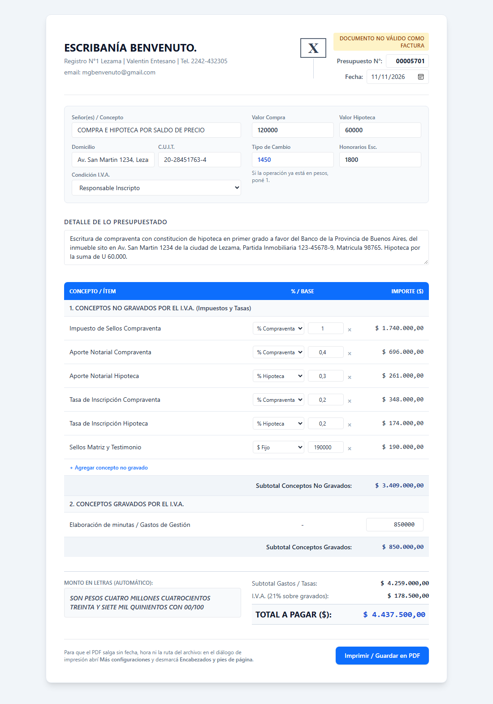

# Generador de presupuestos para escribanía

Aplicación web de una sola página para armar presupuestos de operaciones
inmobiliarias (compraventa e hipoteca) y exportarlos a PDF en una hoja A4.

Sin build, sin dependencias instaladas y sin servidor: se abre `index.html` en el
navegador y se trabaja.



## Qué calcula

Cargás los importes a mano, en pesos, y la planilla resuelve sola los subtotales,
el IVA y el total.

**Conceptos no gravados por IVA** (la tabla arranca **vacía**: cada concepto se
agrega a mano y después se puede renombrar o eliminar)

Los seis conceptos que usa la escribanía, como referencia:

- Impuesto de sellos sobre la compraventa
- Aporte notarial de compraventa
- Aporte notarial de hipoteca
- Tasa de inscripción de compraventa
- Tasa de inscripción de hipoteca
- Sellos de matriz y testimonio

Cada fila lleva su nombre y un importe en pesos escrito a mano: no hay base de
cálculo ni porcentajes, y el importe es exactamente el que se tipea. El subtotal
se recalcula solo al agregar, editar o borrar filas. Sin filas cargadas la sección
no se imprime. En el PDF cada fila imprime únicamente concepto e importe.

**Conceptos gravados por IVA**

- Elaboración de minutas / gastos de gestión

El IVA es del 21% y se aplica únicamente sobre los conceptos gravados. Al
imprimir, los importes salen formateados en lugar del número crudo.

## Salida

- Locale `es-AR`, moneda ARS, siempre dos decimales.
- Monto en letras automático, con formato notarial:
  `SON PESOS ... CON 00/100`.
- Detalle libre de lo presupuestado, sin recorte de texto al exportar.
- Exportación a **una sola página A4** en blanco y negro: sin fondos, colores,
  sombras ni cajas de formulario.
- Los campos vacíos no imprimen su texto de ayuda. Si no hay conceptos no
  gravados cargados, esa sección no se imprime; si no hay detalle, tampoco.
- Se puede cargar desde el teléfono o la tablet: en pantallas chicas la tabla se
  apila (concepto arriba, importe y botón de borrar abajo) y el PDF sale igual
  que desde la computadora.

## Cómo se usa

1. Abrí `index.html` con doble clic.
2. Completá el número de presupuesto, la fecha y los datos del cliente
   (concepto, domicilio, CUIT y condición frente al IVA).
3. Cargá a mano el importe de cada concepto: no hay valores de operación, tipo de
   cambio ni honorarios que completar.
4. Agregá los conceptos no gravados con el botón de la tabla: cada fila lleva su
   nombre y un importe en pesos, y se renombran o se borran ahí mismo.
5. Presioná **Imprimir / Guardar en PDF**.
6. En el diálogo de impresión abrí *Más configuraciones* y desmarcá
   *Encabezados y pies de página*. La fecha, la hora y la ruta del archivo las
   agrega el navegador, no la página: solo se sacan desde ahí.

## Estructura

| Archivo | Qué hace |
| --- | --- |
| `index.html` | Todo el marcado y las clases de Tailwind. |
| `css/style.css` | Estilos de pantalla y el bloque `@media print` completo. |
| `js/script.js` | Cálculos, formato de moneda y monto en letras. |
| `assets/` | Ícono del sitio. |
| `AGENTS.md` | Convenciones del proyecto y contrato de impresión. |

Tailwind se carga por CDN, así que no hay `node_modules` ni paso de compilación.

## Ramas

`main` es la versión publicable, `staging` el candidato congelado para revisar y
`develop` la rama de trabajo. La promoción es manual y siempre por merge:
`develop` → `staging` → `main`. No se commitea directo en `staging` ni en `main`.

El repositorio trae un hook que hace cumplir esa regla. Git no versiona su propia
configuración, así que después de clonar hay que activarlo:

```bash
git config core.hooksPath .githooks
```

## Limitaciones conocidas

- No hay tests automatizados: la verificación es manual, abriendo la página y
  revisando la vista previa de impresión.
- El documento se exporta en blanco y negro por diseño; el color de la interfaz
  no se traslada al papel.
- Los datos no se guardan en ningún lado: al cerrar la página se pierden.
